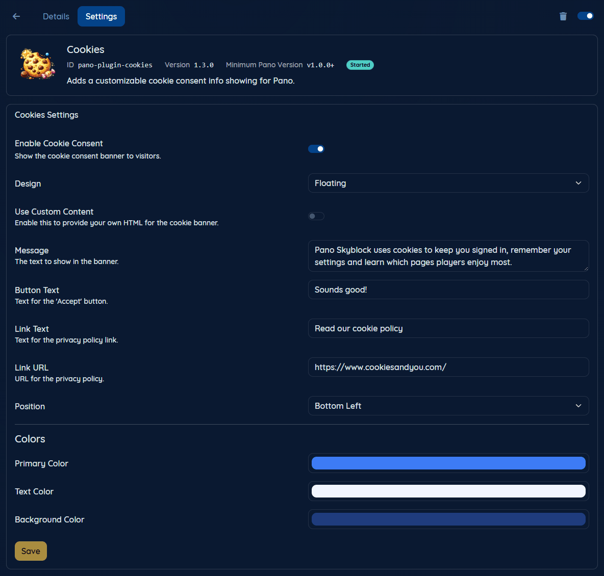

  
  <h1>Cookies</h1>
  
<b>A friendly cookie notice that matches your website in minutes.</b>

  

    
    
    
  

Cookies shows visitors a clear notice that your website uses cookies, with a link to your policy and an accept button. Pick a style, write your own message and match the colors to your website. It takes a minute to set up and needs no coding.

## ✨ Features
- 🍪 **Three styles**: Show a slim bar, a floating card or a centered popup.
- 📍 **Flexible position**: Place it at the top, bottom or in any corner of the screen.
- ✏️ **Your own words**: Change the message, button text and policy link.
- 🎨 **Match your colors**: Set the button, text and background colors to fit your website.
- 🧩 **Custom content**: Want something special? Use your own HTML for the notice.
- ✅ **Shown once**: After a visitor accepts, the notice stays hidden for them.
- 🔌 **On or off anytime**: Turn the notice on or off with one switch.

## 📸 Screenshots

<i>Set the style, text, position and colors from the panel.</i>

## 🚀 Get started
1. Open your Pano panel and go to **Addons**.
2. Find **Cookies** and click **Install**.
3. Open the addon's **Settings** tab, choose a style and colors, then click **Save**.

## 💬 Support
Questions or ideas? Join our [Discord](https://panomc.com/discord) or visit [panomc.com](https://panomc.com).

## 📄 License
Released under the MIT License.
